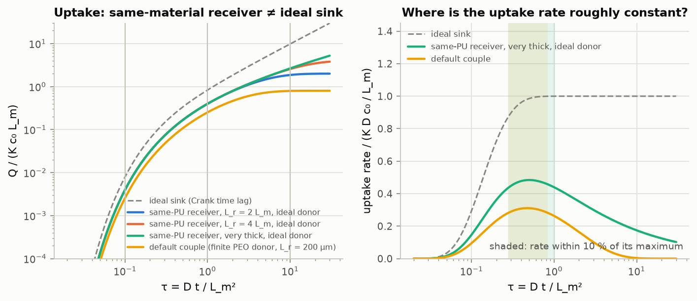
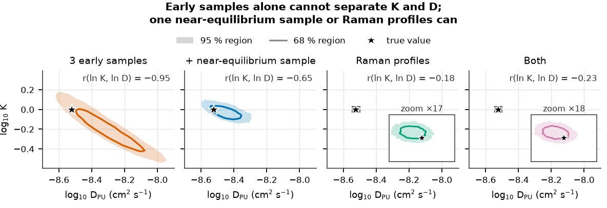
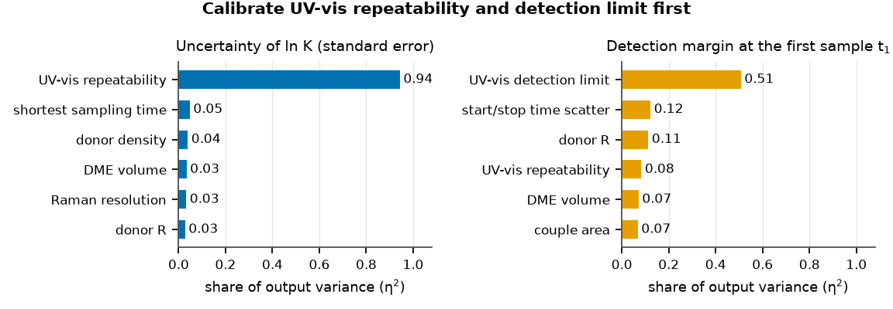
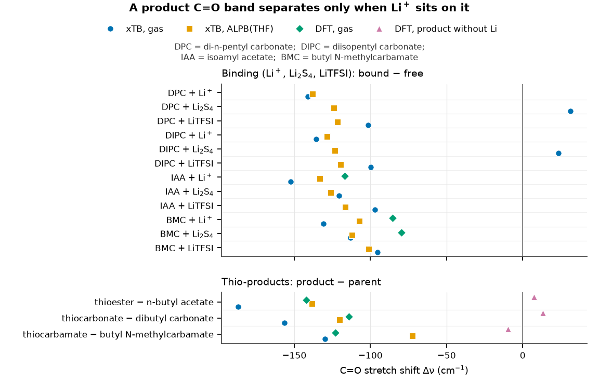

# Computational design toolkit for a polymer electrolyte experiment (Li–S batteries)

Kaiming Zhang

A series of polyurethane (PU) solid electrolytes with different soft-segment structures is used to study
polysulfide shuttling in lithium–sulfur batteries. All seven PUs share an HDI/1,4-butanediol hard segment:

| Code | Soft segment (Mn ≈ 2000) | Group | Branch | Sites (mmol g⁻¹ soft) |
|---|---|---|---|---|
| PU-EG | poly(ethylene glycol) | ether, C2 | – | 22.7 |
| PU-TMG | poly(tetramethylene ether) glycol | ether, C4 | – | 13.9 |
| PU-PO3 | poly(trimethylene ether) glycol | ether, C3 | – | 17.2 |
| PU-PPG | poly(propylene glycol) | ether, C2 | methyl | 17.2 |
| PU-HC | poly(hexamethylene carbonate) diol | carbonate | – | 6.9 |
| PU-MPC | 3-methyl-1,5-pentanediol-rich polycarbonate diol | carbonate | methyl | 6.9 |
| PU-MPA | poly(3-methyl-1,5-pentylene adipate) diol | ester | methyl | 8.8 |

## What the computation changed in the experiment

1. **Diffusion-couple model.** A verified 1-D model of the PEO-donor │ PU-membrane │ PU-receiver couple
   showed that the receiver is not an ideal sink (peak uptake rate 0.31–0.48 of
   K·D·c₀/L), so the permeability is fitted with the full model instead of the slope method. The planned
   first sample is below quantification in 22 of 28 scenarios, K and D separate
   only with a near-equilibrium sample or Raman profiles, and the UV-vis detection limit is calibrated first.
2. **Analysis pipeline.** Impedance, polarisation, thermal, spectroscopic, diffusion-couple and cell data
   are analysed automatically with propagated uncertainties (27 of 37 known truths
   recovered within 3 % on synthetic data). The tests changed the impedance weighting, added a significance
   test for the saturation limit and added matched LiTFSI reference films.
3. **Molecular calculations.** xTB screening with counterpoise-corrected DFT checks showed that binding
   differences of a few kJ mol⁻¹ are not resolved, so they are not used. Harmonic frequencies showed that a
   reaction-product C=O band separates from the parent band only when Li⁺ sits on it, so the FTIR test gets
   an un-aged control and products are confirmed by NMR of model compounds.
4. **Predictions written before the experiment.** 43 rule-based entries (22 directional),
   each with a threshold or interval, a decision rule and a scoring script, fixed before the first synthesis
   (version 2).

## Methods and tools

Finite-volume diffusion model verified against a Laplace-domain solution; emcee Bayesian inversion and
identifiability; global sensitivity analysis; GFN2-xTB; B3LYP-D3(BJ) with counterpoise correction;
harmonic frequencies; pytest (61 tests) and seeded, reproducible runs.

## Figures

> All inputs are assumed values. The figures are drawn from stored results of the toolkit.

---

### 1. The PU receiver is not an ideal sink

  

**What it shows.** Receiver uptake rate relative to the ideal steady rate K·D·c0/Lm. The PU receivers peak at only 0.31–0.48 of it (shaded: the default couple stays within 10 % of its peak for τ = 0.27–0.84).

**Why it matters.** The classic time-lag slope would underestimate the permeability, so K and D are fitted with the full model instead.

---

### 2. Early samples alone cannot separate K and D

  

**What it shows.** Posterior regions of K and DPU from synthetic data (assumed DPU = 3 × 10−9 cm2 s−1, K = 1). Three early samples give a long ridge (r = −0.95); a near-equilibrium sample or Raman profiles shrink it (r = −0.65, −0.18, −0.23).

**Why it matters.** The plan includes one near-equilibrium sample or Raman profiles, so that K and D can be measured separately.

---

### 3. Calibrate UV-vis first

  

**What it shows.** Share of variance (η2) of two design outputs explained by each unknown input, with DPU and K fixed. UV-vis repeatability explains 0.94 of the uncertainty of ln K; the detection limit explains 0.51 of the detection margin at the first sample.

**Why it matters.** These two calibrations come first, before any PU film exists.

---

### 4. FTIR can miss or mimic the reaction

  

**What it shows.** Computed C=O shifts on binding (top) and for thio-products against their parent esters (bottom). A product C=O lies 114–142 cm−1 below its parent only when the Li of S4Li sits on it; without Li it stays within 14 cm−1 (DFT). Positive xTB values: Li2S4 on the alkoxy O.

**Why it matters.** An un-aged control film and model-compound NMR are added, because FTIR alone cannot confirm the reaction.

---

📄 **Two-page summary:** [application_summary.pdf](application_summary.pdf) · [application_summary.docx](application_summary.docx)

## Limitations

All inputs are assumptions and there are no experimental data yet. Single model molecules cannot
represent the polymer, and DFT was used at validation level only. The code was written with the assistance
of the AI coding assistant Claude Code (Claude Opus 5.5, max effort); the scientific questions, mappings
and decision rules were set by me.

Full code and design reports are available on request.
